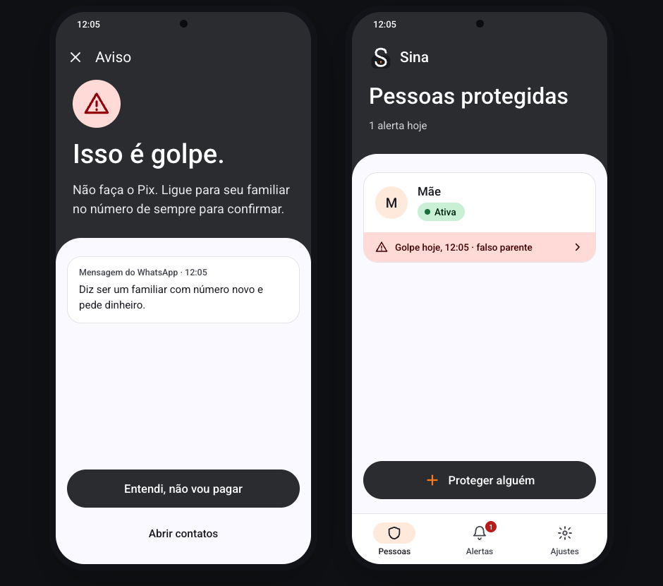
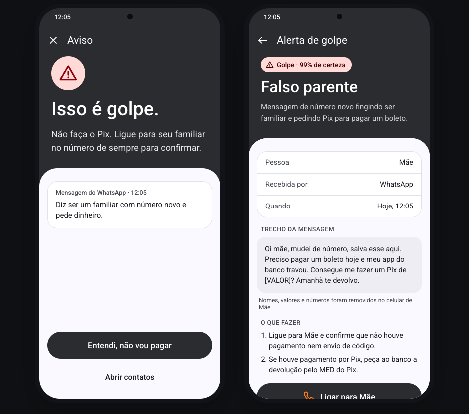

# Sina

**O aviso que chega antes do Pix.**

O Sina é um app Android que protege pessoas idosas de golpes recebidos por SMS e WhatsApp. Quando chega uma mensagem suspeita, a pessoa vê na hora um aviso claro do que fazer, e um familiar é avisado no celular dele e por e-mail.

Projeto do **Hack Brasil 2026**, trilha **Cibersegurança**.

| | |
| --- | --- |
| Demonstração no navegador, sem instalar nada | https://demo.sina.ia.br |
| Site | https://sina.ia.br |
| Vídeo de apresentação | _adicionar o link_ |



## O problema

O Brasil registrou **2.261.055 casos de estelionato em 2025**, um recorde: cerca de 4 por minuto, com crescimento de 429,8% desde 2018 (20º Anuário Brasileiro de Segurança Pública). Muitos golpes começam com uma mensagem como esta:

> Oi mãe, mudei de número, salva esse aqui. Preciso pagar um boleto hoje e meu app do banco travou. Consegue me fazer um Pix de R$ 1.850,00? Amanhã te devolvo.

O golpe usa pressa, medo e carinho. Pessoas idosas são o alvo preferido, e quase nunca têm alguém por perto na hora de decidir se pagam ou não. Os filtros de spam das operadoras e do WhatsApp não pegam esse tipo de mensagem, porque ela parece uma conversa normal de família.

## A solução

O Sina fica no celular da pessoa protegida e confere cada notificação de SMS e WhatsApp que chega:

1. **A mensagem chega.** O app lê só o texto que aparece na notificação. Ele não abre conversas e não usa a API do WhatsApp.
2. **Os dados pessoais saem de cena, no próprio celular.** O nome de quem mandou, telefones, CPF, e-mails, valores, links e códigos viram marcadores como `[NOME]`, `[VALOR]` e `[TELEFONE]` antes de qualquer envio.
3. **A inteligência artificial decide.** A API envia o texto anonimizado para análise e recebe um veredito: golpe, suspeita ou mensagem normal, com o tipo de golpe e a certeza.
4. **A pessoa é avisada.** Se for golpe, aparece um aviso grande, em linguagem simples, dizendo o que fazer: "Não faça o Pix. Ligue para seu familiar no número de sempre."
5. **A família fica sabendo.** O familiar ligado recebe uma notificação e um e-mail com o tipo do golpe, um resumo e um trecho sem dados pessoais, e pode ligar para a pessoa com um toque.
6. **A proteção é vigiada.** Se o celular da pessoa protegida parar de mandar sinal por 30 minutos, por exemplo porque o acesso às notificações foi desligado, o familiar é avisado.

Há dois papéis, cada um no seu celular:

- **Pessoa protegida:** aceita a privacidade, faz um cadastro rápido, libera o acesso às notificações e mostra um código ou QR para ligar o familiar.
- **Familiar:** faz o cadastro, digita ou escaneia o código e passa a receber os alertas, o histórico e o estado da proteção.



## Experimente

A forma mais rápida é a demonstração no navegador: **https://demo.sina.ia.br**. Ela mostra os dois celulares lado a lado, com todas as telas do app, ligados à API real. Todos os dados são fictícios.

1. Siga as telas de boas-vindas nos dois celulares e confirme o cadastro, que já vem preenchido.
2. Na pessoa protegida, toque em **Ligar familiar**. No familiar, digite o código de 8 números.
3. Toque em **Simular golpe**. A análise é feita de verdade pela IA, e o aviso aparece nos dois celulares.

Também dá para testar uma mensagem normal, ver o histórico de alertas, desligar a proteção e ver o familiar ser avisado, ou excluir a conta.

## Exemplo da análise

O texto que sai do celular já vem anonimizado, junto com sinais calculados no próprio aparelho:

```http
POST /v1/analyze
Authorization: Bearer <deviceToken>
Content-Type: application/json

{
  "source": "WHATSAPP",
  "text": "Oi mãe, mudei de número, salva esse aqui. Preciso pagar um boleto hoje e meu app do banco travou. Consegue me fazer um Pix de [VALOR]? Amanhã te devolvo.",
  "localSignals": ["URGENCY", "PIX_REQUEST", "UNKNOWN_SENDER"],
  "receivedAt": "2026-11-16T14:20:00Z",
  "messageCount": 1
}
```

Resposta:

```json
{
  "verdict": "SCAM",
  "scamType": "FALSE_RELATIVE",
  "confidence": 0.99,
  "elderlyMessage": "Isso é golpe. Não faça o Pix. Ligue para seu familiar no número de sempre para confirmar.",
  "engine": "LLM",
  "alertId": "7677c6ae-a67e-47a7-a722-6f6a2beee0c2",
  "guardianNotified": true
}
```

- `verdict`: `SCAM` (golpe), `SUSPICIOUS` (suspeita) ou `SAFE` (normal).
- `scamType`: falso parente, falsa central do banco, falsa entrega, falso prêmio ou dívida, link suspeito, pedido de código, falso investimento, falso benefício ou conta clonada.
- `engine`: `LLM` (análise pela IA), `CACHE` (mesmo texto analisado nos últimos 7 dias) ou `RULES` (regras locais, usadas se a IA não responder).
- O familiar só é avisado quando o veredito é golpe com certeza de pelo menos 0,8.

## Qualidade da detecção

Avaliamos a IA com 100 mensagens fictícias: 50 golpes dos nove tipos acima mais 2 tentativas de manipular a IA, 40 mensagens legítimas e 10 ambíguas. As mensagens legítimas incluem casos difíceis, como código de banco com aviso de "não compartilhe", Pix recebido, fatura e um filho alertando sobre o golpe do falso parente. As ambíguas são casos como consignado, vaquinha e aluguel com sinal. Cada mensagem é anonimizada exatamente como no app e enviada à API em produção.

| Métrica | Resultado |
| --- | --- |
| Golpes detectados (golpe ou suspeita) | **50 de 50 (100%)** |
| Golpes em que a família é avisada | 47 de 50 (94%) |
| Mensagens legítimas marcadas por engano | **1 de 40 (2,5%)** |
| Falsos alarmes para a família | **0 de 40** |
| Tipo de golpe identificado corretamente | 44 de 45 (97,8%) |
| Tentativas de manipular a IA ("ignore as instruções…") | 2 de 2 detectadas como golpe |
| Tempo de resposta da IA (mediana / p95) | 2,4 s / 3,7 s |

Os três golpes que não chegaram à família foram marcados como suspeita: o idoso recebe o aviso, mas a certeza ficou abaixo de 0,8. A única mensagem legítima marcada por engano foi um aviso de transferência realizada, que gerou só uma suspeita, sem avisar a família.

O conjunto é pequeno e escrito pela equipe. Ele serve para comparar versões do prompt e mostrar o comportamento esperado; não é uma taxa de acerto medida no mundo real. O relatório completo, com a matriz de confusão e os erros, está em [`eval/RESULTADOS.md`](eval/RESULTADOS.md). Para repetir a avaliação:

```bash
python3 eval/avaliar.py --api http://localhost:8081
```

## Arquitetura

```
 Celular da pessoa protegida          API (Spring Boot)                Celular do familiar
┌────────────────────────────┐      ┌──────────────────────────┐      ┌──────────────────────┐
│ lê a notificação           │      │ cache por hash (7 dias)  │      │ notificação (FCM)    │
│ anonimiza no aparelho      │ ───▶ │ OpenAI ou regras locais  │ ───▶ │ e-mail (Resend)      │
│ mostra o aviso             │ ◀─── │ grava o alerta           │      │ histórico e estado   │
│ manda sinal de vida        │      │ vigia o sinal de vida    │      │ ligar para a pessoa  │
└────────────────────────────┘      └────────────┬─────────────┘      └──────────────────────┘
                                                 │
                                           PostgreSQL
```

| Camada | Tecnologia |
| --- | --- |
| App Android | Kotlin, Jetpack Compose, WorkManager, Retrofit |
| API | Java 21, Spring Boot 4 |
| Banco | PostgreSQL 18 com Flyway |
| Inteligência artificial | OpenAI (Responses API, saída estruturada) |
| Notificações | Firebase Cloud Messaging |
| E-mail | Resend |
| Demonstração | HTML e JavaScript puros, ligados à mesma API |

```
sina/
├── app/          app Android (Kotlin)
├── api/          API (Java, Spring Boot)
├── docs/
│   ├── demo/     demonstração no navegador
│   └── img/      imagens deste README
├── eval/         avaliação da IA com mensagens fictícias
└── README.md
```

## Como executar

### API

Requisitos: Docker. Para rodar sem Docker, Java 21 e um PostgreSQL.

1. Copie `api/.env.example` para `api/.env` e preencha:
   - `OPENAI_API_KEY` e `OPENAI_MODEL`;
   - `DB_POSTGRES`, `DB_USER` e `DB_PASSWORD` do banco;
   - `DEVICE_TOKEN_PEPPER`, um segredo aleatório com pelo menos 32 caracteres;
   - opcionais: `RESEND_API_KEY` e `MAIL_FROM` para o e-mail, e o JSON da conta de serviço do Firebase em `api/secrets/firebase.json` para as notificações.
2. Suba a API e o banco:
   ```bash
   cd api
   docker compose up -d --build
   ```
3. Confira se está no ar:
   ```bash
   curl http://localhost:8081/health
   # {"status":"UP"}
   ```

Sem a chave da OpenAI, a análise usa só as regras locais. Sem Firebase ou Resend, a API funciona e só deixa de enviar por aquele canal.

Para rodar os testes, com um PostgreSQL disponível:

```bash
cd api
./mvnw verify
```

### Testar a API pelo terminal

```bash
# 1. Cadastra a pessoa protegida e guarda o token
TOKEN=$(curl -s -X POST http://localhost:8081/v1/devices \
  -H 'Content-Type: application/json' \
  -d '{"role":"PROTECTED","displayName":"Dona Maria","email":"maria@example.com","phone":"(11) 90000-0001"}' \
  | python3 -c "import sys,json; print(json.load(sys.stdin)['deviceToken'])")

# 2. Analisa uma mensagem já anonimizada
curl -s -X POST http://localhost:8081/v1/analyze \
  -H "Authorization: Bearer $TOKEN" -H 'Content-Type: application/json' \
  -d '{"source":"SMS","text":"CORREIOS: sua encomenda está retida. Pague a taxa de [VALOR] em [LINK:ent-rastreio.top] em até 24h.","localSignals":["URGENCY","PIX_REQUEST","UNKNOWN_SENDER"],"receivedAt":"2026-11-16T14:20:00Z","messageCount":1}'

# 3. Exclui o cadastro de teste
curl -s -X DELETE http://localhost:8081/v1/devices/me -H "Authorization: Bearer $TOKEN"
```

### Demonstração local

A demonstração é um único arquivo HTML. Para apontá-la para a API local, libere a origem no CORS da API (`CORS_ORIGINS=http://localhost:8099` no `.env`, depois `docker compose up -d`) e rode:

```bash
cd docs/demo
python3 -m http.server 8099
```

Abra `http://localhost:8099/?api=http://localhost:8081`. Sem o parâmetro `api`, ela usa a API publicada.

### App Android

Requisitos: Android Studio e um projeto Firebase com o app `br.ia.sina` cadastrado.

1. Coloque o `google-services.json` do seu projeto Firebase em `app/app/`. Ele não fica no repositório.
2. Abra a pasta `app/` no Android Studio, ou gere o APK pelo terminal informando o endereço da API:
   ```bash
   cd app
   ./gradlew assembleDebug -Psina.apiBaseUrl=http://10.0.2.2:8081/
   ```
   `10.0.2.2` é o endereço do computador visto pelo emulador. Para um celular real, use o endereço da API publicada.
3. Instale em um aparelho ou emulador com Android 8 ou superior.

No Android 13 ou superior, um APK instalado fora da Play Store precisa da opção **Permitir configurações restritas**, nas informações do app, antes de liberar o acesso às notificações.

## API

Autenticação por `Authorization: Bearer <deviceToken>`. A API guarda só o hash do token.

| Método e caminho | Quem usa | O que faz |
| --- | --- | --- |
| `GET /health` | público | Verifica se a API está no ar |
| `POST /v1/devices` | público | Cadastra o aparelho (nome, e-mail e telefone) e devolve o token |
| `PUT /v1/devices/me/fcm-token` | ambos | Atualiza o token de notificação |
| `POST /v1/devices/me/heartbeat` | protegido | Sinal de vida do app |
| `DELETE /v1/devices/me` | ambos | Exclui a conta, as ligações e os alertas |
| `POST /v1/pairing-codes` | protegido | Gera o código de 8 números para ligar um familiar, válido por 10 minutos |
| `POST /v1/pairings` | familiar | Usa o código e cria a ligação |
| `GET /v1/pairings` | ambos | Lista as ligações e o estado da proteção |
| `DELETE /v1/pairings/{id}` | ambos | Desfaz a ligação |
| `POST /v1/analyze` | protegido | Analisa o texto anonimizado de uma mensagem |
| `GET /v1/alerts` | familiar | Histórico de alertas, paginado |

Erros vêm no formato `{"error": {"code": "...", "message": "..."}}`.

## Privacidade

- O texto é anonimizado no celular antes de sair dele. O nome de quem mandou, telefones, CPF, e-mails, valores, links e códigos são trocados por marcadores e não chegam à API.
- A OpenAI recebe só o texto anonimizado, sem armazenamento (`store: false`).
- O Sina guarda o cadastro (nome, e-mail e telefone), as ligações, o resultado das análises e o texto anonimizado dos alertas, limitado a 300 caracteres. O texto original da mensagem nunca é guardado.
- O cache de análises usa só o hash do texto e expira em 7 dias.
- O telefone de cadastro só é visto por quem está ligado à pessoa.
- A conta pode ser excluída a qualquer momento nos ajustes do app, o que apaga o cadastro, as ligações e os alertas.
- A pessoa protegida vê e aceita tudo isso antes de ativar a proteção.
- A demonstração e os exemplos usam apenas dados fictícios.

## Limitações

- Funciona só no Android. O iOS não permite ler notificações de outros apps.
- Não vê mensagens sem notificação nem notificações com a pré-visualização oculta.
- A classificação é uma estimativa de risco, não uma certeza. Por isso o familiar só é avisado com certeza alta.
- O app ainda não está na Play Store; a demonstração no navegador é a forma de testar sem instalar.

## Equipe

_Adicionar os nomes e os links dos perfis._

## Licença

MIT. Veja o arquivo [`LICENSE`](LICENSE).
